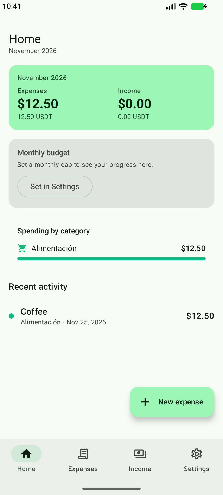
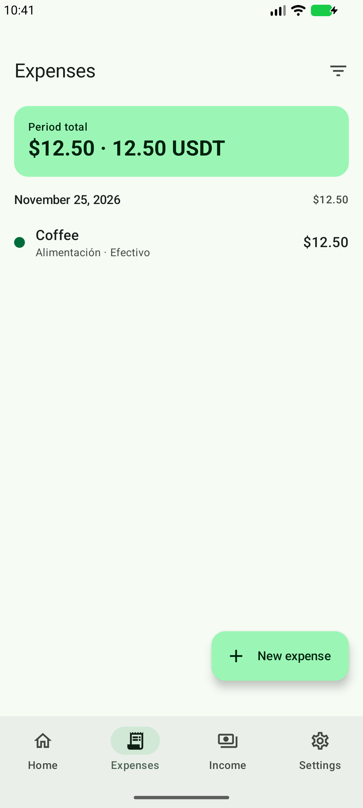
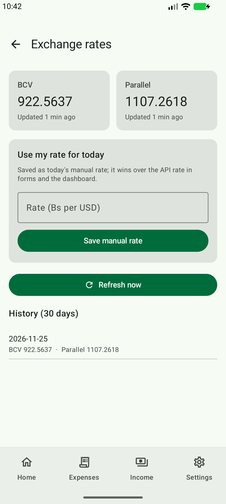
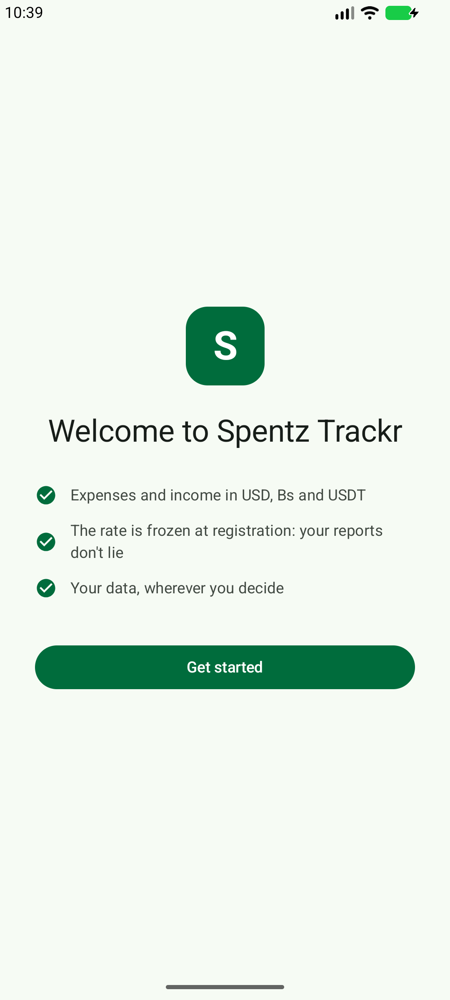
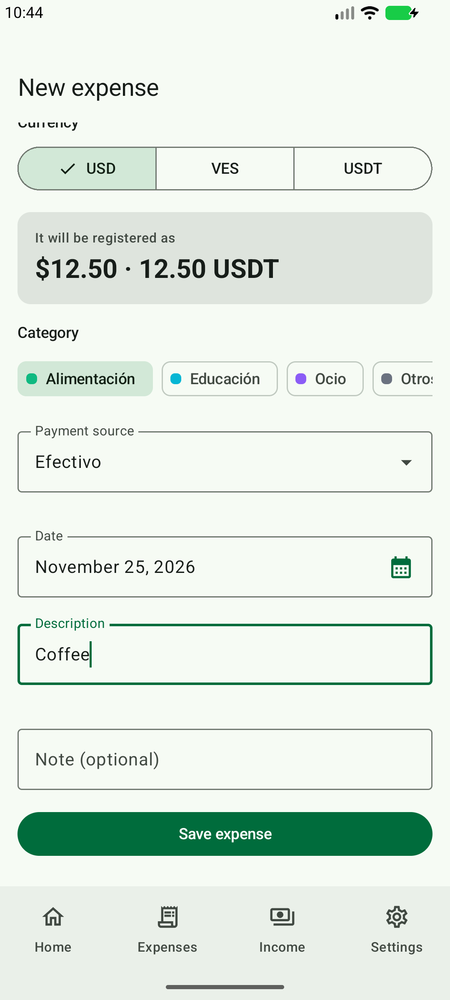
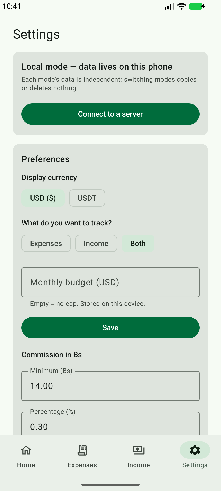

# Spentz Trackr — Android (Kotlin)

**Cliente Android nativo de [Spentz Trackr](https://github.com/SuricatoAviones/spentz-trackr)**, el control de
gastos e ingresos multi-moneda (USD · Bs · USDT) open source y auto-hospedable.

Kotlin · Jetpack Compose · Material 3 · Room (SQLite) · Retrofit · Hilt · WorkManager.

---

## ¿Qué es?

La app Android de Spentz Trackr. Al primer arranque eliges cómo usarla:

- **Modo remoto** — te conectas a tu propia instancia del backend (la URL donde lo tienes
  hospedado). La app habla con la API REST `/api/v1` (tokens Sanctum) y tus datos viven en
  tu servidor, igual que en la web.
- **Modo local** — la app funciona sola, sin servidor: todo se guarda en SQLite en el
  teléfono, con la misma lógica de negocio (conversión congelada, comisiones Bs, tasas
  BCV/paralelo desde [ve.dolarapi.com](https://ve.dolarapi.com)).

El modo se puede cambiar después en **Ajustes**; cambiar de modo no copia ni borra datos.

## Funcionalidad de la v1

- **Gastos** en USD, Bs y USDT, con comisión Bs (`max(mínimo, monto × %)`), método de pago,
  origen, categoría, fecha, nota y equivalente USD/USDT **congelado al escribir**.
- **Ingresos** con tasa congelada en Bs y su propio catálogo de categorías.
- **Categorías** con presupuesto mensual, icono y color; borrado bloqueado si tienen
  movimientos.
- **Orígenes de pago** editables.
- **Tasas** BCV y paralelo: sincronización con dolarapi (WorkManager ~6 h), refresco
  perezoso al abrir formularios, override manual del día, histórico de 30 días y badge
  **Estimada** cuando no hay red (la app nunca se bloquea por la tasa).
- **Dashboard** con totales del mes, presupuesto global y por categoría, mini-gráfico por
  categoría y últimos movimientos.
- **Ajustes completos**: moneda de visualización, tipo de seguimiento, presupuesto,
  comisiones, tema (claro/oscuro/sistema), idioma (ES/EN/sistema), perfil remoto y
  Acerca de.
- **Bilingüe** español (por defecto) e inglés, con paridad de claves.
- **Sin telemetría, analítica ni blobs propietarios**; licencia MIT, objetivo F-Droid.

## Estado

✅ **v1.0.0 — Fase 7 (pulido y release) completada** en la rama `fase/7-pulido`
(PR a `main`). Plan en [`docs/07-plan-de-fases.md`](docs/07-plan-de-fases.md),
tablero en [`docs/08-backlog-tareas.md`](docs/08-backlog-tareas.md) y flujo de
trabajo en [`AGENTS.md`](AGENTS.md). El detalle de versiones está en
[`CHANGELOG.md`](CHANGELOG.md).

## Requisitos

- Android 8.0 (API 26) o superior.
- JDK 17 (el JBR de Android Studio sirve).
- Android SDK con `compileSdk 37` / `targetSdk 36`.
- Android Studio reciente (AGP 9.3.3 + Gradle 9.7.0 + Kotlin 2.4.21).

## Compilar y ejecutar

```powershell
# Windows (PowerShell)
$env:JAVA_HOME = "C:\Program Files\Android\Android Studio\jbr"
.\gradlew.bat assembleDebug
.\gradlew.bat test
.\gradlew.bat ktlintCheck lint
```

```bash
# Linux / macOS / CI
./gradlew assembleDebug test ktlintCheck lint
```

Instala el APK de debug en un emulador o teléfono:

```powershell
adb install -r app/build/outputs/apk/debug/app-debug.apk
```

El detalle del entorno (Android Studio, emulador, SDK) está en
[`docs/09-entorno-y-herramientas.md`](docs/09-entorno-y-herramientas.md).

## Conectar con tu backend

1. Instala el backend de [SuricatoAviones/spentz-trackr](https://github.com/SuricatoAviones/spentz-trackr)
   en tu servidor.
2. En el onboarding elige **Conectar a mi servidor**.
3. Escribe la URL **sin** `/api/v1` (ej. `gastos.midominio.com`); la app añade la ruta.
4. Inicia sesión con tu cuenta (o crea una si el servidor lo permite).

Si la URL es `http://`, la app avisa de que la conexión no va cifrada. Para uso real,
usa HTTPS. La app **no** llama a dolarapi en modo remoto: las tasas las resuelve tu
servidor.

## Release

El APK de release se firma con un keystore **fuera del repositorio**:

```powershell
Copy-Item keystore.properties.example keystore.properties
# edita storeFile, storePassword, keyAlias y keyPassword
.\gradlew.bat assembleRelease
```

Salida: `app/build/outputs/apk/release/app-release.apk`.
Sin `keystore.properties`, Gradle genera un APK **unsigned** (válido para CI/lint).
No commitees nunca `keystore.properties` ni el `.jks`; haz copia de seguridad del
keystore: sin él no podrás actualizar la app en Google Play/F-Droid.

## Privacidad y F-Droid

- Modo local: los movimientos no salen del teléfono. La única petición externa es a
  `ve.dolarapi.com` para las tasas.
- Modo remoto: la app solo habla con la URL de tu servidor.
- Sin SDK de analítica, crash reporting ni publicidad. Ver
  [`docs/10-fdroid.md`](docs/10-fdroid.md) para el empaquetado y la metadata de F-Droid.

## Capturas

Capturas reales de la v1.0.0 en un emulador API 37 (onboarding local, un gasto
de ejemplo y tasas BCV/paralelo reales):

| Inicio | Gastos | Tasas |
|---|---|---|
|  |  |  |

| Onboarding | Formulario de gasto | Ajustes |
|---|---|---|
|  |  |  |

El resto (estado vacío de Inicio, selección de modo, setup local y ajustes de
apariencia) vive en [`docs/screenshots/`](docs/screenshots/). Se regeneran con
un emulador API 37; ver [`docs/screenshots/README.md`](docs/screenshots/README.md).

## Arquitectura

- **Clean-ish por capas**: `domain` (modelos, repositorios y servicios puros),
  `data` (Room/Retrofit/DataStore) y `feature` (Compose + ViewModel).
- **Un contrato, dos fuentes** (ADR-A01): repositorios local/remoto + delegador por modo.
- **Dinero exacto** (ADR-A03): `BigDecimal`, sin `Double`; Room guarda texto canónico.
- **Conversión congelada** (ADR-001): los equivalentes USD/USDT se calculan al escribir y
  no se recalculan.
- **Sin Hilt en tests**: los repositorios son interfaces y los tests usan fakes.

Detalle en [`docs/02-arquitectura.md`](docs/02-arquitectura.md).

## Documentación

| Documento | Descripción |
|---|---|
| [`docs/README.md`](docs/README.md) | Índice de la documentación |
| [`docs/01-vision-y-alcance.md`](docs/01-vision-y-alcance.md) | Visión, decisiones de producto y alcance v1 |
| [`docs/02-arquitectura.md`](docs/02-arquitectura.md) | Arquitectura técnica y ADRs |
| [`docs/03-modelo-de-datos.md`](docs/03-modelo-de-datos.md) | Esquema Room local y DTOs de la API |
| [`docs/04-onboarding-y-modos.md`](docs/04-onboarding-y-modos.md) | Primer arranque, modo remoto/local y cambio de modo |
| [`docs/05-integracion-api.md`](docs/05-integracion-api.md) | Endpoints, auth Sanctum y manejo de errores |
| [`docs/06-diseno-ui.md`](docs/06-diseno-ui.md) | Pantallas, navegación y componentes |
| [`docs/07-plan-de-fases.md`](docs/07-plan-de-fases.md) | Plan de fases con criterios de salida |
| [`docs/08-backlog-tareas.md`](docs/08-backlog-tareas.md) | Backlog de tareas detallado |
| [`docs/09-entorno-y-herramientas.md`](docs/09-entorno-y-herramientas.md) | Android Studio / IntelliJ, emulador y convenciones |
| [`docs/10-fdroid.md`](docs/10-fdroid.md) | Empaquetado, metadata y publicación en F-Droid |
| [`CONTRIBUTING.md`](CONTRIBUTING.md) | Cómo contribuir: ramas, tests, estilo y PRs |
| [`CHANGELOG.md`](CHANGELOG.md) | Historial de versiones (SemVer) |

## Contribuir

Issues y pull requests bienvenidos. Lee [CONTRIBUTING.md](CONTRIBUTING.md) antes de
empezar; el flujo de fases y commits está en [`AGENTS.md`](AGENTS.md).

## Seguridad

¿Encontraste un fallo? **No abras un issue público.** Usa el canal de
[SECURITY.md](https://github.com/SuricatoAviones/spentz-trackr/blob/main/SECURITY.md)
del proyecto.

## Licencia

[MIT](LICENSE).
