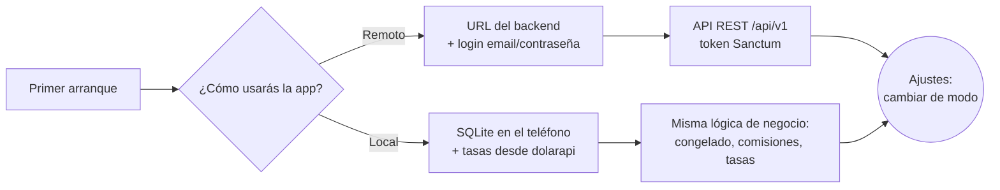

# 01 — Visión y Alcance

App Android nativa del control de finanzas multi-moneda **Spentz Trackr**: registrar
gastos e ingresos en USD, Bs y USDT con la **tasa congelada al momento de la
transacción**, respondiendo de un vistazo *¿cuánto gasté y cuánto gané este mes, en USD y
en USDT?*

## El problema

Spentz Trackr web ya resuelve el problema de fondo para Venezuela (tres monedas
conviviendo y una tasa que se mueve a diario). Quedan dos huecos que solo una app nativa
cierra bien:

1. **Registar debe tardar segundos, desde cualquier parte.** Abrir el navegador, esperar
   la PWA y navegar hasta el formulario no compite con una app en el bolsillo, un FAB y un
   formulario precargado con la tasa del día.
2. **No todo el mundo quiere (o puede) montar un servidor.** El modo local da la app
   completa, con la misma matemática, en un teléfono sin backend.

## Decisiones de producto (confirmadas)

Estas cuatro decisiones moldean todo el diseño y ya fueron aprobadas:

| # | Decisión | Consecuencia |
|---|---|---|
| D-01 | **UI en Jetpack Compose** (Material 3) | Un solo Activity, UI declarativa, tema claro/oscuro desde el día 1. Nada de XML layouts. |
| D-02 | **v1 = núcleo primero** | La v1 entrega: onboarding con modos, gastos, ingresos, categorías, orígenes, tasas y dashboard. Metas de ahorro, pagos recurrentes, tarjetas, IA y reportes avanzados quedan para fases posteriores. |
| D-03 | **Modo local con tasa automática**: la app llama a `ve.dolarapi.com` directamente (BCV + paralelo), cachea la tasa del día y permite override manual | Misma experiencia que la web; funciona sin backend pero con datos frescos. |
| D-04 | **El modo es cambiable en Ajustes** | Se elige en el primer arranque, pero no es una cárcel: puedes empezar en local y luego conectar tu servidor. Los datos de cada modo no se mezclan ni migran solos (ver `04-onboarding-y-modos.md`). |

## Modos de uso

- **Remoto**: la instancia del backend es la fuente de verdad. Requiere una instalación de
  [spentz-trackr](https://github.com/SuricatoAviones/spentz-trackr) (Docker, VPS,
  cPanel…) accesible desde el teléfono.
- **Local**: la app es autocontenida. Ideal para probar Spentz Trackr sin infraestructura
  y para quienes no quieren salir de su teléfono.

## Alcance de la v1

- [x] Onboarding de primer arranque con elección de modo (remoto con URL + login, local
      con configuración rápida).
- [x] **Gastos**: CRUD completo, tres monedas, comisión Bs (`pago móvil`/`transferencia`)
      precalculada y editable, tasa precargada (BCV/paralelo/manual) y congelada al
      guardar, filtros por mes/categoría/moneda.
- [x] **Ingresos**: CRUD con las tres monedas y tasa congelada.
- [x] **Categorías y orígenes de pago**: CRUD, colores/iconos, categorías de gasto e
      ingreso, set inicial por defecto.
- [x] **Tasas**: sincronización con `ve.dolarapi.com` (BCV + paralelo), override manual
      por día e histórico. En remoto delega en la API del backend.
- [x] **Dashboard**: totales del mes en USD y USDT, presupuesto global y por categoría,
      últimos movimientos.
- [x] Ajustes: moneda de visualización, tipo de seguimiento, presupuesto mensual,
      comisión mínima y porcentaje, tema claro/oscuro, idioma ES/EN, cambio de modo.
- [x] Bilingüe ES/EN desde el primer commit.

### Fuera de la v1 (backlog post-v1, en orden tentativo)

- Gastos **mixtos** (`expense_items`) — el esquema local ya lo contempla, la UI no.
  *(Nota: se re-evalúa; puede entrar en v1 si la fase de gastos avanza rápido.)*
- Comprobantes adjuntos (fotos de facturas).
- Metas de ahorro y pagos recurrentes.
- Tarjetas de crédito (cortes, abonos, saldo híbrido).
- Reportes avanzados: comparativo 12 meses, estado de cuenta, exportación CSV.
- Asistente de IA (BYOK) y escaneo de facturas.
- Sincronización offline-first entre modos (caché Room + motor de sync).
- Widgets de escritorio, notificaciones de presupuesto.

## Público

1. **Auto-hospedadores** que ya corren la web en su servidor y quieren el teléfono
   conectado a *sus* datos.
2. **Usuarios solo-móvil** que quieren Spentz Trackr sin montar nada.

## Principios

1. **Software libre, sin trampas**: MIT, sin telemetría, sin analítica, sin blobs
   propietarios (objetivo: publicable en F-Droid).
2. **Tus datos no salen de donde tú decides**: en remoto solo hablan con la URL que
   escribas; en local no hay red salvo `ve.dolarapi.com` para la tasa.
3. **Paridad con la web**: las reglas de negocio del backend son la especificación; donde
   el backend dice "congelado", la app dice congelado. Los ADRs del backend se respetan.
4. **La app funciona sin backend**: el modo local no es una versión recortada, es la
   misma lógica con otro almacenamiento.
5. **Se desarrolla en español**; la app es bilingüe (ES/EN).

## Métricas de éxito de la v1

- Registrar un gasto en Bs con comisión toma **menos de 20 segundos** desde el FAB.
- El gasto congelado hoy muestra el mismo equivalente USD/USDT dentro de un año.
- Un usuario nuevo llega al dashboard funcional **sin leer documentación**.
- La suite de tests del dominio (conversión, comisiones, tasas) está en verde en CI.
