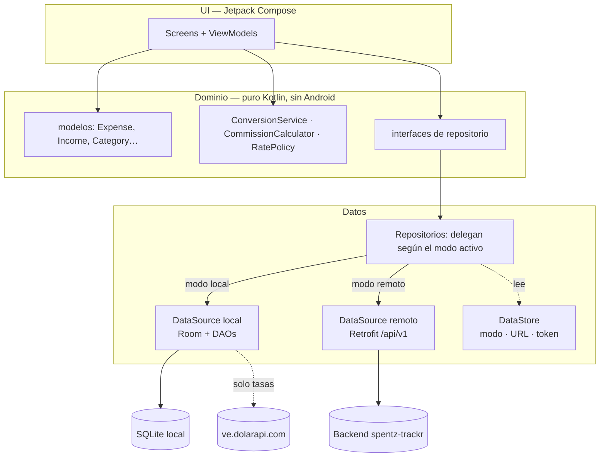
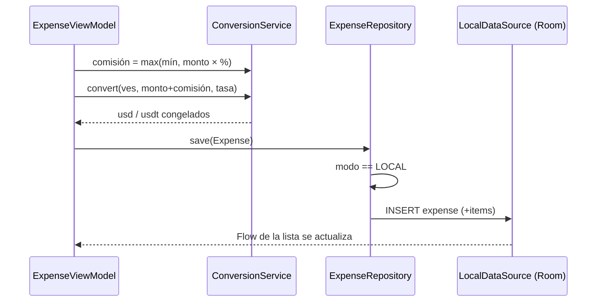

# 02 — Arquitectura

## Stack

| Capa | Tecnología | Notas |
|---|---|---|
| Lenguaje | Kotlin (última estable soportada por AGP) | Coroutines + Flow |
| UI | Jetpack Compose + Material 3 | Un solo Activity, Navigation-Compose |
| Diseño | Material 3, tema claro/oscuro, dynamic color opcional | Ver `06-diseno-ui.md` |
| Persistencia local | Room (SQLite) | Espejo del esquema de negocio del backend |
| Preferencias | DataStore (Preferences) | Modo, URL del servidor, token, onboarding |
| Red | Retrofit + OkHttp + kotlinx-serialization | Interceptor de auth, timeouts, errores |
| DI | Hilt | Módulos por capa |
| Trabajo en background | WorkManager | Sincronización periódica de tasas (modo local) |
| Fechas | kotlinx-datetime | `LocalDate` para `spent_at`/`received_at`/`rate_date` |
| Tasas | `https://ve.dolarapi.com/v1/dolares` (modo local) | BCV + paralelo, igual que el backend |
| Tests | JUnit + Turbine + kotlinx-coroutines-test + Compose UI test | Dominio con tests obligatorios |
| Calidad | ktlint (formato) + CI en GitHub Actions | Build + lint + tests en cada push |
| Min / Target SDK | 26 (Android 8.0) / última estable | Ver ADR-A09 |

## Arquitectura por capas

MVVM con dominio explícito. La regla que gobierna todo: **la lógica de negocio vive en
el dominio, es puro Kotlin, y la comparten ambos modos** — igual que el backend comparte
Actions entre web y API (ADR-007 del backend).



### Flujo de un alta de gasto (modo local)



En modo remoto el mismo `save(Expense)` viaja a `POST /api/v1/expenses` y el congelado
lo hace el backend; la UI no cambia.

## Estructura de paquetes (módulo único `:app`)

```
app/src/main/java/io/github/suricatoaviones/spentztrackr/
├── SpentzApplication.kt          # @HiltAndroidApp
├── MainActivity.kt                # único Activity, host de Compose
├── core/
│   ├── money/                    # Money (BigDecimal), CurrencyCode, RateProvider,
│   │                             #   TypeConverters Room ↔ TEXT canónico
│   ├── designsystem/             # tema M3, componentes compartidos (MoneyField, chips…)
│   └── util/                     # fechas, formato de montos por locale
├── domain/
│   ├── model/                    # Expense, Income, Category, PaymentSource,
│   │                             #   ExchangeRate, Dashboard, UserPreferences
│   ├── service/                  # ConversionService, CommissionCalculator,
│   │                             #   RatePolicy, DashboardAggregator
│   └── repository/               # interfaces: ExpenseRepository, …
├── data/
│   ├── settings/                 # DataStore: modo, URL, token, prefs de UI
│   ├── local/                     # Room: SpentzDatabase, entidades, DAOs, converters
│   ├── remote/                    # Retrofit: SpentzApi, DTOs, AuthInterceptor,
│   │                              #   mapeadores DTO ↔ dominio
│   └── repository/                # implementaciones que delegan según modo
├── feature/
│   ├── onboarding/               # bienvenida, elección de modo, login remoto, setup local
│   ├── home/                     # dashboard, presupuesto, recientes
│   ├── expenses/                 # lista, detalle, formulario
│   ├── incomes/
│   ├── catalog/                  # categorías y orígenes
│   ├── rates/                    # tasas del día, override manual, histórico
│   ├── settings/                 # ajustes + cambio de modo
│   └── widget/                   # post-v1: Glance (ver docs/12)
└── di/                           # módulos Hilt
app/src/test/                     # unit tests del dominio y viewmodels (JVM)
app/src/androidTest/               # tests de Room y de UI Compose
```

Los widgets son **post-v1** y no viven en la UI Compose normal: se implementan con
Glance en `feature/widget/`, leen snapshots cacheados y nunca hacen red en
`provideGlance`. Diseño y contratos en [`12-widgets.md`](12-widgets.md).

## Decisiones registradas (ADR de Android)

### ADR-A01 — Doble modo resuelto en la capa de repositorios
`DataStore` guarda `mode` (`remote | local`) y las implementaciones de repositorio delegan
al datasource activo. La UI y los ViewModels **nunca** conocen el modo: piden datos al
repositorio y punto. Cambiar de modo es cambiar una preferencia (ADR/D-04); no requiere
reiniciar la app porque los repos leen el modo en cada operación.
*Descartado*: dos "apps" distintas o inyectar implementaciones distintas por build flavor
— duplica UI y complica el cambio de modo.

### ADR-A02 — Dominio puro compartido por ambos modos
`ConversionService` / `CommissionCalculator` / `RatePolicy` son Kotlin puro sin
dependencia de Room, Retrofit ni Android. En **local** producen los valores congelados
que se persisten; en **remoto** precargan/validan el formulario (la conversión autorativa
la hace el backend, pero la UI necesita mostrar el equivalente al vuelo). Espejo del
ADR-007 del backend (Actions compartidas web/API).
*Consecuencia*: los tests del dominio (JVM, rápidos) son la red de seguridad de las
reglas de dinero.

### ADR-A03 — Dinero con `BigDecimal`, persistencia en TEXT; jamás `Double`
El backend usa `DECIMAL(14,2)` y tasas `DECIMAL(14,4)` y prohíbe `FLOAT` (ver
`03-modelo-de-datos.md` del backend). Kotlin: los montos y tasas son `BigDecimal` en el
dominio; Room los guarda como **TEXT decimal canónico** (ej. `"280.00"`, `"28.0000"`) vía
`TypeConverter`; los DTOs JSON aceptan número o string (Laravel serializa DECIMAL como
string). Redondeo: `HALF_UP` a 2 decimales en montos y 4 en tasas.
*Descartado*: centavos en `Long` (Correcto pero más frágil con tasas a 4 decimales y
montos en Bs de muchos dígitos) y `Double` (descartado de plano).

### ADR-A04 — Heredamos ADR-001/002 del backend sin re-discutirlos
USDT se trata 1:1 con USD; la conversión se **congela al escribir** y los reportes nunca
recalculan. La tasa por transacción viaja con el gasto; `exchange_rates` solo precarga el
formulario. La app Android no re-inventa estas reglas: las replica (local) o las delega
(remoto). Si algún día el backend las cambia, la app hereda el cambio.

### ADR-A05 — El esquema Room es un espejo del esquema de negocio del backend
Mismas tablas y columnas que el ER del backend (`expenses`, `incomes`, `categories`,
`payment_sources`, `exchange_rates`, `expense_items`…) con las mismas reglas (`amount` es
la base sin comisión; `usd_amount`/`usdt_amount` congelados al insertar). Facilita:
paridad de comportamiento verificable contra los tests del backend, migraciones
predecibles, y un futuro motor de sincronización offline sin remodelar.
*Descartado*: un esquema "mobile-first" renombrado — rompería la paridad gratis.

### ADR-A06 — Retrofit + OkHttp + kotlinx-serialization para la API
Retrofit sobre OkHttp con `Json { ignoreUnknownKeys = true }` de kotlinx-serialization.
`AuthInterceptor` añade `Authorization: Bearer <token>`; un `Interceptor` raíz fija la
`baseUrl` desde DataStore (la URL es del usuario, no de compilación). Timeouts:
connect 15 s / read 30 s.
*Descartado*: Ktor client (viable, pero Retrofit sigue siendo el estándar con más
material de referencia para contribuidores de un proyecto FOSS).

### ADR-A07 — Hilt para DI
Estándar de facto Android, soporte de `@HiltViewModel`, integración con WorkManager.
Nada exótico: un contribuidor medio de Android lo conoce.

### ADR-A08 — Módulo único `:app` con paquetes limpios
La v1 es un módulo Gradle. La separación por capas es de paquetes, verificable por
convención. Multi-módulo (`:core:domain`, `:feature:expenses`, …) se evalúa cuando haya
estabilidad y una razón (build times, reuse); antes es sobrecarga para un FOSS de este
tamaño.

### ADR-A09 — minSdk 26 (Android 8.0), targetSdk última estable
26 cubre >95% de dispositivos activos y habilita java.time/ICU moderno; no perseguimos
API < 26 porque la app es nueva (sin base de usuarios legacy) y el costo de soportar
 Marshmallow/Nougat es real (workarounds de fechas y permisos).

### ADR-A10 — Token Sanctum en almacenamiento cifrado
El token (90 días de vida en el backend) se guarda en `EncryptedSharedPreferences`
(clave en Android Keystore). `GET /api/v1/auth/me` valida el token al entrar en modo
remoto; un 401 lleva a la pantalla de re-login. No guardamos la contraseña.
*Alternativa descartada*: pegar tokens creados en la web — fricción; login directo es la
misma superficie que la PWA.

### ADR-A11 — HTTP sin TLS permitido, con advertencia explícita
Muchos auto-hospedajes caseros corren en LAN sin TLS. Se permite cleartext vía *network
security config*, y la UI marca la conexión como insegura cuando la URL es `http://`.
En remoto los datos financieros viajan como el usuario decida — es su servidor.

### ADR-A12 — Sin telemetría, compatible F-Droid
Cero analítica, cero crash-reporting third-party (los logs van a Logcat). Sin
dependencias binarias propietarias ni Play Services obligatorios (solo APIs del sistema
y librerías FOSS/Apache). El release se firma y puede publicarse fuera de Play.

### ADR-A13 — i18n con recursos estándar
`res/values/strings.xml` en español (default, como el proyecto) y `res/values-en/`.
Paridad de claves obligatoria (un test la verifica, como `I18nDictionaryTest` del
backend). Fechas y montos con `java.text.NumberFormat`/`DateTimeFormatter` según locale.

### ADR-A14 — El modo local es "single-user"
SQLite local tiene un único usuario implícito; las preferencias personales
(`default_display_currency`, `monthly_budget`, comisiones, etc.) viven en una tabla
`user_prefs` espejo de las columnas del `users` del backend. Sin login local en v1
(mirar bloqueo biométrico como post-v1 si se pide).

## Estrategia de pruebas

1. **Dominio (obligatoria, JVM)**: conversión por moneda, congelado, comisión
   `max(mín, %)`, tasa vigente (manual > api del día > última conocida), avance de fechas.
   Casos con montos reales tomados de los tests del backend cuando existan.
2. **Repositorios**: DAOs con Room in-memory (androidTest) y API con `MockWebServer`.
3. **ViewModels**: Turbine para Flows, fakes de repositorios.
4. **UI**: Compose UI test para el flujo de alta de gasto (el más complejo) y el
   onboarding de modos.

## CI

GitHub Actions: `push`/`PR` → `./gradlew lint ktlintCheck test` (JVM) y en `main` también
`assembleDebug`. Sin emulador en CI en la v1 (los androidTest corren en local).
