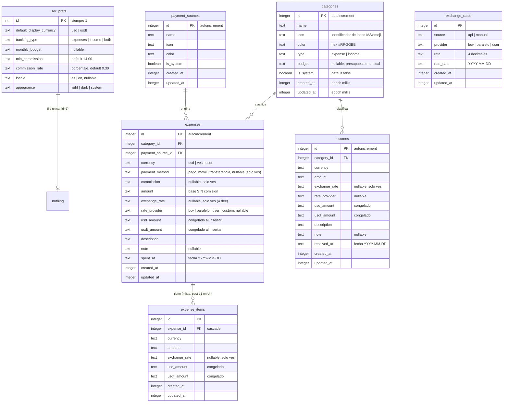

# 03 — Modelo de Datos

Dos almacenes, un modelo. El **dominio** (`domain/model`) es único; cada modo lo materializa
distinto: **Room/SQLite** en local, **DTOs JSON** en remoto. El esquema local es espejo del
ER del backend (`spentz-trackr/docs/03-modelo-de-datos.md`) — solo tablas de negocio, sin
infraestructura Laravel.

Regla de dinero (ADR-A03): `BigDecimal` en Kotlin, **TEXT decimal canónico** en Room,
número-o-string en JSON. Montos a 2 decimales, tasas a 4, redondeo `HALF_UP`.

## Diagrama ER — esquema local v1 (Room)

La tabla **se crea completa en la Fase 2** (incluida `expense_items`) aunque su UI llegue
después: es más barato crearla vacía que escribir una migración en la fase siguiente.

### Índices (espejo del backend)

- `expenses`: `(spent_at)`, `(category_id)`, `(currency)`, `(spent_at, category_id)`
- `incomes`: `(received_at)`, `(category_id)`, `(currency)`
- `exchange_rates`: **único** `(source, provider, rate_date)`
- FKs con `onDelete = RESTRICT` para `categories`/`payment_sources` (no se borra una
  categoría con gastos; igual que el backend) y `CASCADE` para `expense_items`.

## Reglas por entidad (heredadas del backend)

### `expenses`
- `amount` guarda la **base**; la comisión va en su columna. El equivalente USD/USDT se
  calcula sobre `amount + commission`.
- `usd` → `usd_amount = amount`; `usdt` → `usdt_amount = amount` (1:1, ADR-001 backend);
  `ves` → `usd_amount = (amount + commission) / exchange_rate`, `usdt_amount = usd_amount`.
- `exchange_rate` **obligatoria y > 0** cuando `currency = ves`.
- `payment_method` y `commission` solo existen con `currency = ves`.
- `usd_amount` / `usdt_amount` se calculan **una vez al insertar** y jamás se recalculan
  (congelado, ADR-001 backend). Los reportes suman esos campos.
- `spent_at` es **fecha**, no timestamp. Todo agrupado por día va sobre ella.

### `incomes`
Análogo sin comisión, sin método y sin ítems. `received_at` es la fecha.

### `exchange_rates`
- `source = api` con `provider = bcv | paralelo`: lo trae la sincronización con
  `ve.dolarapi.com`.
- `source = manual` con `provider = user`: override del usuario para ese día.
- **Tasa vigente para un día** (`RatePolicy`): su `manual` más reciente del día → si no,
  la `api` más reciente del día → si no, la última conocida marcada como *estimada*.
  Espejo de `ExchangeRateService::rateForUser` del backend.

### `user_prefs` (espejo de las columnas de `users` del backend)
- `default_display_currency` ∈ {usd, usdt} — moneda principal del dashboard.
- `tracking_type` ∈ {expenses, income, both} — qué pestañas se muestran.
- `min_commission` / `commission_rate` — regla `max(mín, monto × %)` (ADR-006 backend).
- `monthly_budget` — presupuesto global mensual (nullable).

## Configuración que NO va en Room

Modo, URL del servidor, token, onboarding completado, tema e idioma de la UI van en
**DataStore** (ver `04-onboarding-y-modos.md`). Room solo datos de negocio.

## Equivalencias local ↔ remoto

| Dominio | Room (local) | API (remoto) |
|---|---|---|
| `Expense` | `entities.ExpenseEntity` | DTO de `GET/POST /api/v1/expenses` (Presenter del backend) |
| `Income` | `IncomeEntity` | DTO `/api/v1/incomes` |
| `Category` | `CategoryEntity` | DTO `/api/v1/categories` |
| `PaymentSource` | `PaymentSourceEntity` | DTO `/api/v1/sources` |
| `ExchangeRate` | `ExchangeRateEntity` | DTO `/api/v1/rates` |
| `AppSettings` | `user_prefs` + DataStore | `GET /api/v1/auth/me` + `PUT /api/v1/user/profile` |
| Dashboard | agregaciones SQL locales | `GET /api/v1/dashboard` (ya calculado) |

Notas de mapeo:
- **IDs**: en local son autoincrement propios; en remoto son los del servidor. Como cada
  modo usa su propia fuente, no se cruzan (la sincronización offline es post-v1 y cuando
  llegue traerá su estrategia de IDs).
- **DTOs**: definirlos contra la spec OpenAPI (`/api/v1.json`) en la Fase 2 — el backend
  publica el JSON con Scramble. `ignoreUnknownKeys = true` para tolerar campos nuevos.
- Fechas: `"YYYY-MM-DD"` en JSON y TEXT en Room; parse a `LocalDate` con kotlinx-datetime.
