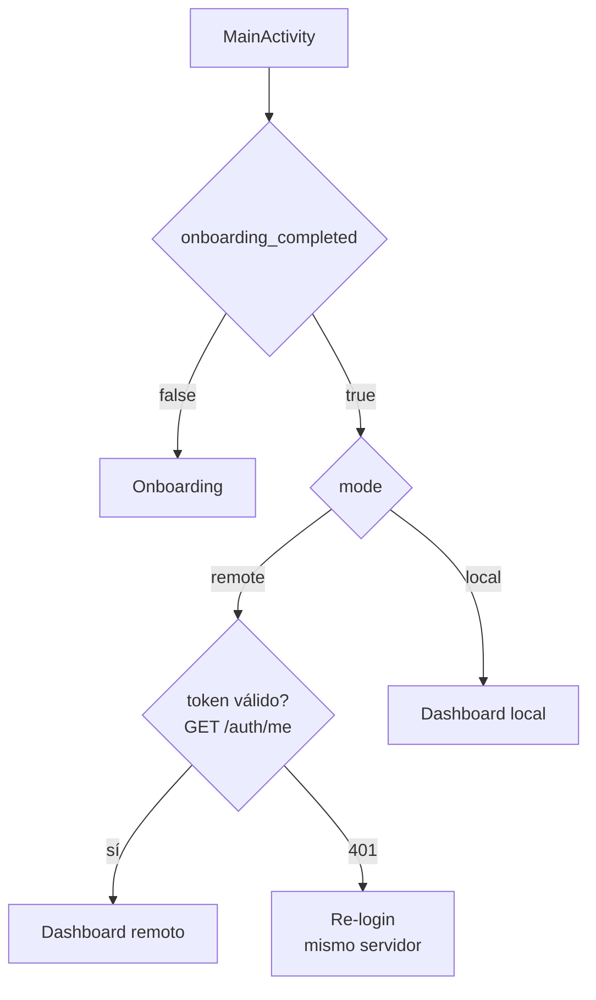
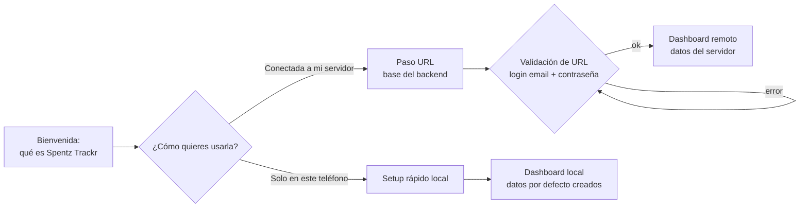
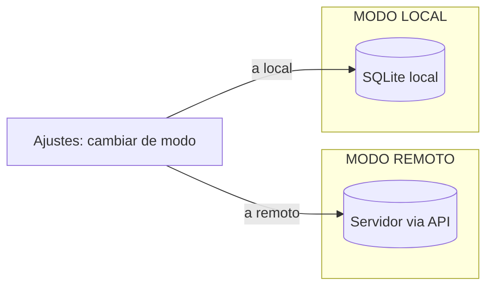

# 04 — Onboarding y Modos

El primer arranque decide la forma de la app: **remota** (tu servidor) o **local**
(SQLite). La decisión es reversible en Ajustes (D-04). Este documento define los flujos,
el estado y las reglas de cambio de modo.

## Estado (DataStore)

| Clave | Tipo | Valores | Descripción |
|---|---|---|---|
| `onboarding_completed` | Bool | `false` al instalar | Gobierna si el arranque abre el onboarding o la app |
| `mode` | String | `local \| remote` | Modo activo |
| `server_url` | String | ej. `https://gastos.midominio.com` | Solo remoto; **sin** `/api/v1` (se añade en el cliente) |
| `auth_token` | String | `1\|abc…` | Solo remoto; en EncryptedSharedPreferences (ADR-A10) |
| `server_user` | String | email | Solo remoto, informativo, para "sesión como…" |
| `theme` | String | `system \| light \| dark` | Apariencia |
| `app_language` | String | `system \| es \| en` | Idioma de la UI |

La app arranca así:

## Flujo de onboarding (primer arranque)

### Pantalla 1 — Bienvenida
Tres ideas, sin texto de más: multi-moneda USD/Bs/USDT, tasa congelada, tus datos donde tú
decidas. Botón: *Empezar*.

### Pantalla 2 — Elección de modo
Dos tarjetas grandes (radio-cards), descripción honesta de cada una:

- **"Conectar a mi servidor"** — Tus datos en tu instancia de Spentz Trackr. Necesitas
  la URL donde lo hospedaste y tu cuenta.
- **"Solo en este teléfono"** — Todo se guarda aquí, en SQLite. La tasa Bs/USD se
  sincroniza desde ve.dolarapi.com; nada más sale del teléfono.

### Rama remota
1. **URL**: un solo campo; se acepta con o sin `https://`, con o sin `/public`. El cliente
   normaliza y compone `{url}/api/v1`. Validación en vivo: no se puede continuar con URL
   vacía o malformada.
2. **Login**: email + contraseña → `POST /api/v1/auth/login`. Feedback específico:
   - URL inalcanzable / timeout → "No se pudo conectar con el servidor. Revisa la URL y
     tu conexión."
   - 401/422 credenciales → "Email o contraseña incorrectos."
   - El servidor responde pero no es spentz-trackr (404 en `/api/v1/auth/login`, HTML en
     vez de JSON) → "Este servidor no parece ser Spentz Trackr."
   - Opcional: registro (`POST /api/v1/auth/register`) con un toggle — la API lo expone.
3. **Éxito**: guardar URL + token + email; `onboarding_completed = true`; `mode = remote`.
   La primera pantalla carga `GET /api/v1/auth/me` + dashboard.

### Rama local
1. **Setup rápido** (todo con defaults razonables, editable después en Ajustes):
   - Moneda de visualización: USD | USDT.
   - Tipo de seguimiento: gastos | ingresos | ambos (espejo de `tracking_type`).
   - Presupuesto mensual (opcional).
2. **Inicialización de datos** (transacción Room):
   - Categorías por defecto (espejo de `AssignDefaultUserDataAction` del backend: mismo
     set de categorías/orígenes, `is_system = true`).
   - `user_prefs` con comisión mínima `14.00` Bs y `0.30` % (defaults del backend).
   - Primera sincronización de tasas (Best-effort: si no hay red, la UI de gastos ofrece
     tasa manual).
3. **Éxito**: `onboarding_completed = true`, `mode = local`.

## Cambio de modo (Ajustes)

Regla cardinal: **cambiar de modo no toca los datos**. Los dos almacenes coexisten y cada
modo lee el suyo:

- **Local → Remoto**: pide URL + login (la misma pantalla del onboarding). El SQLite
  local se conserva intacto; si vuelves al modo local, tus datos siguen ahí.
- **Remoto → Local**: inmediato. El token se conserva; al volver a remoto se revalida con
  `GET /auth/me`.
- La pantalla de cambio muestra un aviso claro:
  *"Los datos de cada modo son independientes. Cambiar de modo no copia ni combina
  información; nada se borra."*
- **Cierre de sesión remoto** (opcional): llama `DELETE /api/v1/auth/logout` y borra
  token; la app vuelve a pedir login al re-entrar en modo remoto.

## Sesión remota y sus estados

| Situación | Detección | Respuesta |
|---|---|---|
| Token expirado (~90 días) o revocado | 401 en cualquier llamada | Pantalla de re-login con el servidor ya configurado |
| Cuenta suspendida | 403 con `EnsureApiUserNotSuspended` | Mensaje: "Tu cuenta está suspendida en el servidor" |
| Servidor caído / sin red | IOException / timeout | Estado offline de la lista con botón "Reintentar" (sin datos cacheados en v1) |
| Throttling (100/min API, 5/min auth) | 429 | Backoff exponencial simple; la UI reintenta sola |

## tracking_type

En remoto llega en `auth/me` (y se edita en la web); en local vive en `user_prefs`.
Gobierna qué pestañas muestra el scaffold inferior: solo Gastos, solo Ingresos, o ambos.
La app lo respeta en ambos modos (espejo del middleware `EnsureTrackingFeature`).
